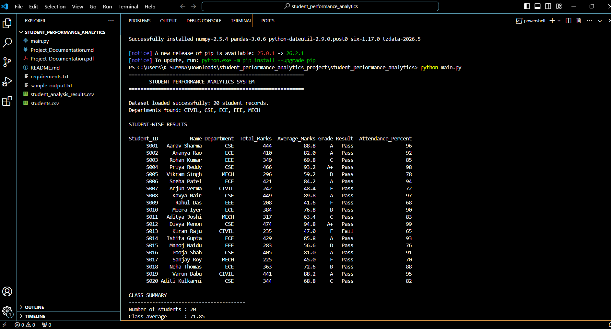
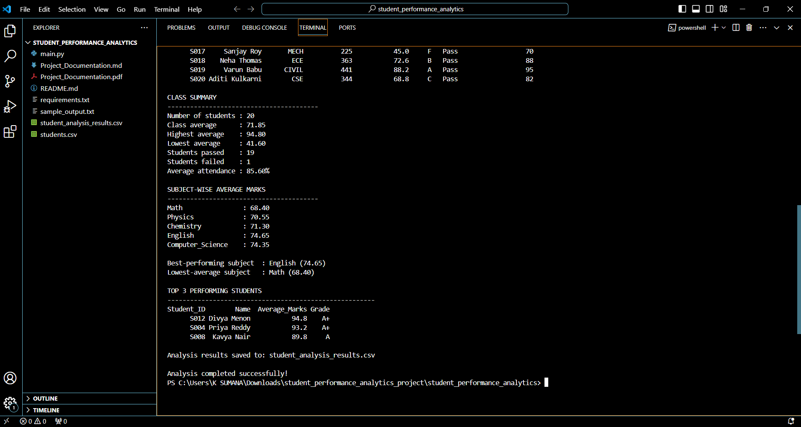

# Project Documentation: Student Performance Analytics System

## 1. Project Title
**Student Performance Analytics System**

Student Name: KONDOJU SUMANA
College: Kakatiya Institute of Technology and Science, Warangal (KITSW) 
Internship: Python with AI  
Repository Link: https://github.com/kondojusumana7-max/student-performance-analytics

## 2. Objective
The objective is to create a Python program that reads student marks and attendance from a CSV file, analyzes the information, and presents useful summaries. It helps organize student results and quickly identify strong and weak subject performance.

## 3. Technologies Used
- Python: program logic, conditions, loops, and functions.
- Pandas: reads the CSV file and organizes data in a DataFrame.
- NumPy: calculates totals and averages.
- CSV: stores the sample student dataset.

## 4. Dataset Description
The sample dataset contains 20 fictional student records. Columns include Student ID, Name, Department, marks in Math, Physics, Chemistry, English and Computer Science, and Attendance Percentage. Each subject is marked out of 100. Attendance is represented as a percentage.

## 5. Implementation
1. `pandas.read_csv()` loads `students.csv` into a DataFrame.
2. The program checks that the required columns exist.
3. NumPy calculates each student's total and average marks.
4. The `assign_grade()` function assigns a grade from the student's average.
5. The `check_pass_fail()` function uses a loop and condition to check whether every subject mark is at least 35.
6. Pandas calculates the class summary and subject-wise averages.
7. The program sorts students by average marks and displays the top three.
8. The calculated table is saved to `student_analysis_results.csv`.

## 6. Key Features
- Student-wise total and average marks.
- Grade assignment.
- Pass/fail status.
- Class average, highest average and lowest average.
- Number of passed and failed students.
- Average attendance.
- Subject-wise averages.
- Top three performers.
- Export of analysis results to CSV.

## 7. Output / Screenshots
The following screenshots show the actual output generated by the Student Performance Analytics System.

### Screenshot 1: Student Analysis Output

### Screenshot 2: Class Summary and Top Performers

The program also generates `student_analysis_results.csv`, containing the analyzed student records, total marks, average marks, grades, and pass/fail status.

## 8. Final Outcome
The program reads the sample dataset, processes the marks, assigns grades, identifies pass/fail status, summarizes class and subject performance, and saves the results to a new CSV file. It demonstrates basic Python programming and data analysis using NumPy and Pandas.

## 9. Challenges & Learning
While completing this project, I learned how to install the required Python libraries and run a Python program using VS Code. I learned how to load student records from a CSV file using Pandas and how to use NumPy to calculate total and average marks. I also understood how functions, loops and conditions can be used to assign grades and determine pass/fail results. This project improved my understanding of basic Python programming and data analysis.

## 10. GitHub Repository
Paste the URL of your completed repository here: https://github.com/kondojusumana7-max/student-performance-analytics

## Grading Rules
- A+: average >= 90
- A: average >= 80 and < 90
- B: average >= 70 and < 80
- C: average >= 60 and < 70
- D: average >= 50 and < 60
- F: average < 50

A student passes only if every subject mark is at least 35. Grade and pass/fail are separate measures.
